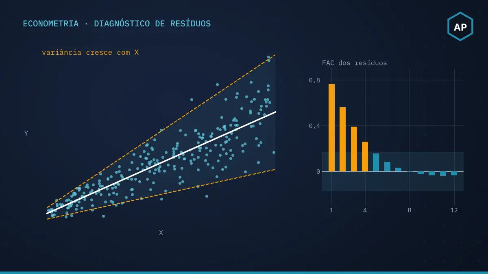

### [A importância da análise de dados na contabilidade](../blog/posts/contabdata/index.llms.md)

Como a análise de dados transforma a prática contábil, com benefícios, desafios e exemplos para a tomada de decisão nas organizações.

30/06/2024

### [Previsão de receita](../blog/posts/preditiva/index.llms.md)

Previsão de receita com séries temporais em R: preparação dos dados, análise exploratória e modelo preditivo com o pacote forecast.

07/06/2024

### [Heterocedasticidade e autocorrelação: como resolver na prática?](../blog/posts/heterocedasticidade/index.llms.md)

Passo a passo em R para identificar, diagnosticar e tratar heterocedasticidade e autocorrelação em modelos de regressão.

22/05/2024

De volta ao topo
