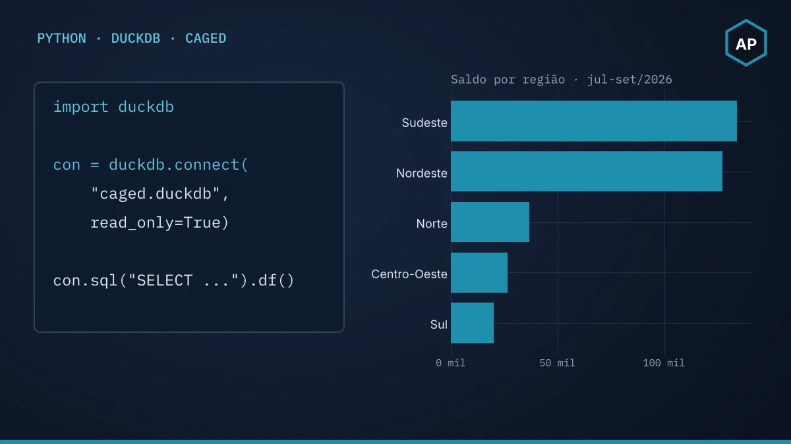
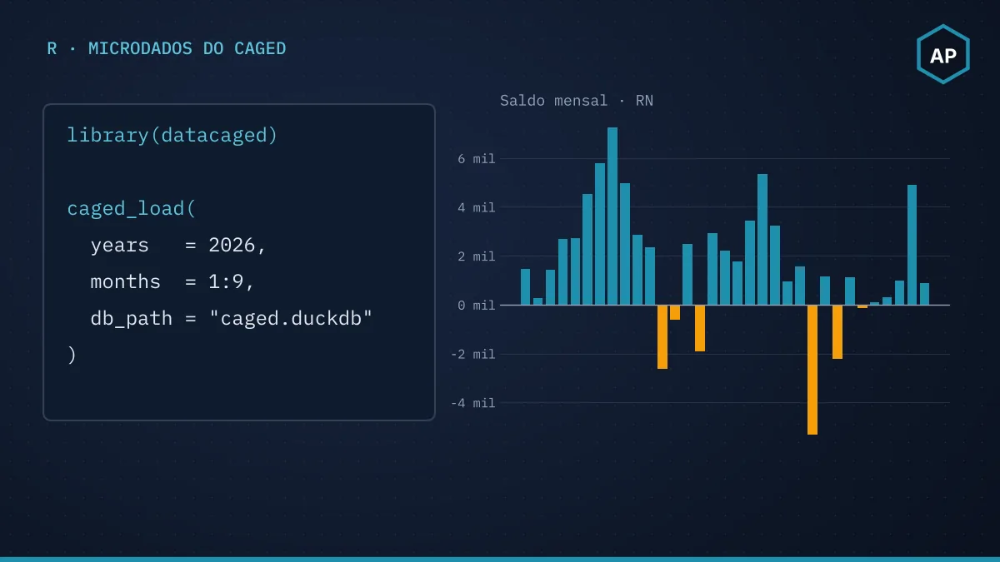
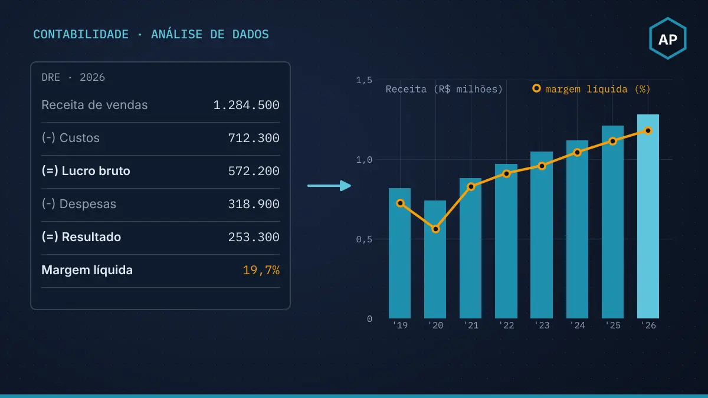
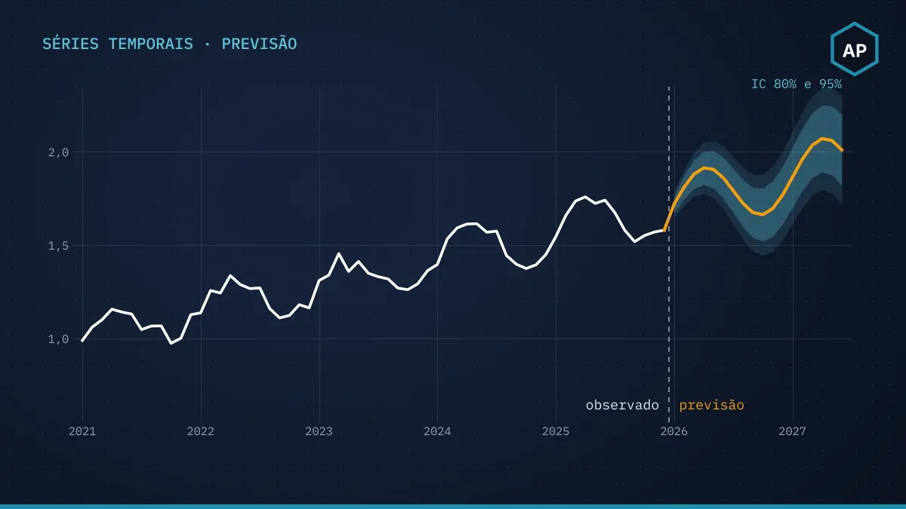

Todos 7

Mercado de trabalho 3

R 3

Contabilidade 2

Econometria 2

Ciência de dados 1

Dados abertos 1

Mercado de capitais 1

Python 1

Mais recente

RPythonMercado de trabalho

### [R e Python no mesmo notebook: o caged.duckdb do datacaged](../blog/posts/datacaged-python/index.llms.md)

Um notebook Quarto (.qmd) que combina R e Python sobre o mesmo banco caged.duckdb: o datacaged carrega os microdados do Novo CAGED, e as duas linguagens consultam, trocam resultados e produzem gráficos.

16 nov 2026 8 min [Ler ](../blog/posts/datacaged-python/index.llms.md)

RMercado de trabalho

### [Microdados do CAGED no R com o pacote datacaged](../blog/posts/datacaged-tutorial/index.llms.md)

Passo a passo para baixar, organizar e consultar os microdados do Novo CAGED em R, com um banco local DuckDB e consultas em dplyr.

16 nov 2026 4 min [Ler ](../blog/posts/datacaged-tutorial/index.llms.md)

ContabilidadeMercado de trabalho

### [O mercado de trabalho contábil em 2026](../blog/posts/mercado-contabil-2026/index.llms.md)

Admissões, desligamentos e salário de admissão de contadores, auditores, peritos, técnicos e auxiliares de contabilidade no Novo CAGED, de janeiro a setembro de 2026.

16 nov 2026 7 min [Ler ](../blog/posts/mercado-contabil-2026/index.llms.md)

Mercado de capitaisDados abertos

### [Segmentos de listagem da B3: um painel verificado de 2010 a 2026](../blog/posts/segmentos-b3/index.llms.md)

Uma base de dados aberta com o segmento de listagem de cada companhia aberta brasileira, ano a ano, construída a partir do Formulário Cadastral da CVM e conferida documento a documento.

16 nov 2026 5 min [Ler ](../blog/posts/segmentos-b3/index.llms.md)

ContabilidadeCiência de dados

### [A importância da análise de dados na contabilidade](../blog/posts/contabdata/index.llms.md)

Como a análise de dados transforma a prática contábil, com benefícios, desafios e exemplos para a tomada de decisão nas organizações.

30 jun 2024 3 min [Ler ](../blog/posts/contabdata/index.llms.md)

EconometriaR

### [Previsão de receita](../blog/posts/preditiva/index.llms.md)

Previsão de receita com séries temporais em R: preparação dos dados, análise exploratória e modelo preditivo com o pacote forecast.

7 jun 2024 5 min [Ler ](../blog/posts/preditiva/index.llms.md)

Econometria

### [Heterocedasticidade e autocorrelação: como resolver na prática?](../blog/posts/heterocedasticidade/index.llms.md)

Passo a passo em R para identificar, diagnosticar e tratar heterocedasticidade e autocorrelação em modelos de regressão.

22 mai 2024 8 min [Ler ](../blog/posts/heterocedasticidade/index.llms.md)

De volta ao topo
