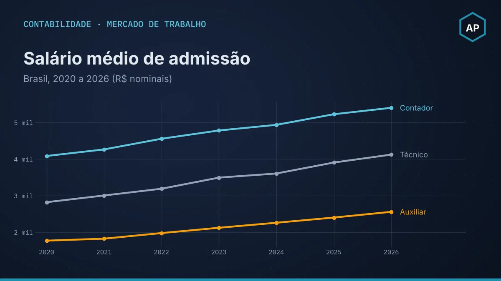
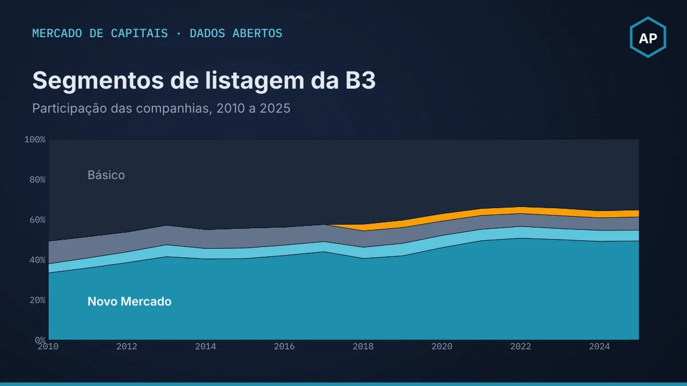

### [Dados do datacaged em Python: consultando o caged.duckdb](../blog/posts/datacaged-python/index.llms.md)

Como abrir em Python o banco caged.duckdb criado pelo pacote datacaged e consultar os microdados do Novo CAGED com DuckDB, pandas e Polars.

16/11/2026

### [Microdados do CAGED no R com o pacote datacaged](../blog/posts/datacaged-tutorial/index.llms.md)

Passo a passo para baixar, organizar e consultar os microdados do Novo CAGED em R, com um banco local DuckDB e consultas em dplyr.

16/11/2026

### [O mercado de trabalho contábil em 2026](../blog/posts/mercado-contabil-2026/index.llms.md)

Admissões, desligamentos e salário de admissão de contadores, auditores, peritos, técnicos e auxiliares de contabilidade no Novo CAGED, de janeiro a setembro de 2026.

16/11/2026

### [Segmentos de listagem da B3: um painel verificado de 2010 a 2026](../blog/posts/segmentos-b3/index.llms.md)

Uma base de dados aberta com o segmento de listagem de cada companhia aberta brasileira, ano a ano, construída a partir do Formulário Cadastral da CVM e conferida documento a documento.

16/11/2026

### [A importância da análise de dados na contabilidade](../blog/posts/contabdata/index.llms.md)

Como a análise de dados transforma a prática contábil, com benefícios, desafios e exemplos para a tomada de decisão nas organizações.

30/06/2024

### [Previsão de receita](../blog/posts/preditiva/index.llms.md)

Previsão de receita com séries temporais em R: preparação dos dados, análise exploratória e modelo preditivo com o pacote forecast.

07/06/2024

### [Heterocedasticidade e autocorrelação: como resolver na prática?](../blog/posts/heterocedasticidade/index.llms.md)

Passo a passo em R para identificar, diagnosticar e tratar heterocedasticidade e autocorrelação em modelos de regressão.

22/05/2024

De volta ao topo
