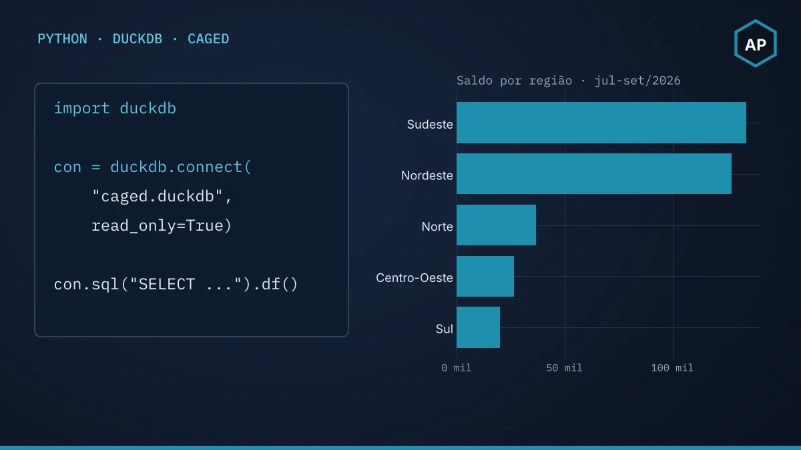
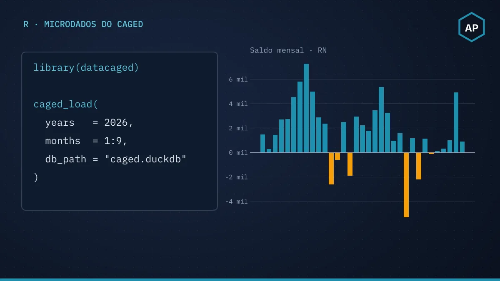
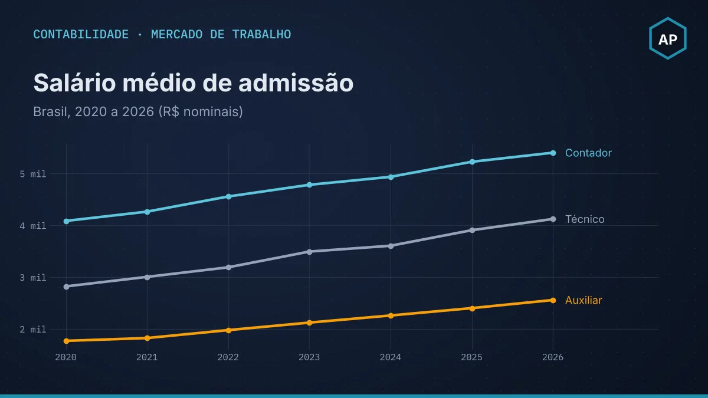

Professor Adjunto do Departamento de Ciências Sociais Aplicadas e Humanas (DCSAH) da Universidade Federal Rural do Semi-Árido (UFERSA), com atuação no curso de Ciências Contábeis desde 2013 e no Programa de Pós-Graduação em Administração (PPGA/UFERSA). Doutor em Economia pela Universidade Federal da Paraíba (UFPB), coordena o Grupo de Estudos sobre Contabilidade e Mercado de Trabalho ([GECOMT](https://gecomt.github.io/)) e integra o Conselho de Curadores da UFERSA.

[64publicações29 artigos em periódicos](publicacoes/index.llms.md) [6produtos técnicossoftware, painel e bases de dados](producao-tecnica/index.llms.md) [ downloads do datacagedno CRAN, desde set/2026](producao-tecnica/index.llms.md#datacaged) [54TCCs orientadosalém de dissertações no PPGA](ensino/index.llms.md#orientacao)

As pesquisas situam-se na interface entre contabilidade, finanças e economia do trabalho, com ênfase em (i) mercado de trabalho formal a partir de microdados administrativos, sobretudo o Cadastro Geral de Empregados e Desempregados (CAGED) e a Relação Anual de Informações Sociais (RAIS); (ii) sustentabilidade, ESG e governança corporativa em companhias abertas brasileiras; e (iii) remuneração de executivos, gerenciamento de resultados e mercado de capitais. Além disso, desenvolve pacotes em R que facilitam o acesso a dados públicos brasileiros para fins de pesquisa.

## Formação

Doutorado em Economia 2021  
Programa de Pós-Graduação em Economia, Universidade Federal da Paraíba (UFPB), com bolsa CAPES. Tese: *Ensaios sobre o uso repetido do seguro-desemprego*. Orientador: Paulo Aguiar do Monte.

Mestrado em Ciências Contábeis 2012  
Programa Multi-institucional e Inter-regional de Pós-Graduação em Ciências Contábeis (UnB/UFPB/UFRN), com bolsa CAPES. Dissertação: *O impacto da adoção da linguagem XBRL sobre a assimetria informacional: uma análise empírica nas empresas brasileiras listadas na Bolsa de Nova Iorque*. Orientador: Paulo Amilton Maia Leite Filho.

Bacharelado em Ciências Contábeis 2008  
Universidade Federal da Paraíba (UFPB).

## Áreas de interesse

- Economia do trabalho e políticas de mercado de trabalho
- Contabilidade financeira e mercado de capitais
- Sustentabilidade, ESG e governança corporativa
- Sistemas de informações contábeis
- Métodos quantitativos aplicados: decomposição de Oaxaca-Blinder, diferenças em diferenças, pareamento por escore de propensão, análise de sobrevivência e painéis dinâmicos

## Prêmios

Melhores trabalhos, Divisão de Ciências Contábeis 2023  
XIV Congresso Nacional de Administração e Contabilidade (AdCont), Programa de Pós-Graduação em Ciências Contábeis da UFRJ.

Melhor trabalho na área de Contabilidade Financeira 2021  
21º USP International Conference in Accounting, FEA/USP.

1º lugar em artigo científico (apresentação oral) 2019  
XV Encontro Norte-Rio-Grandense de Ciências Contábeis, CRC/RN.

## Atuação editorial

- Membro do corpo editorial da *Revista Conhecimento Contábil* (desde 2015).
- Revisor da *Revista de Educação e Pesquisa em Contabilidade* (REPeC), da *Revista Inovar Contábil* e da *Brazilian Business Review* (BBR), com pareceres também para a *Revista Catarinense da Ciência Contábil* e a *Revista Teoria e Prática em Administração*.
- Avaliador de teses no XXIII Consórcio Doutoral da ANPAD (2025).

## Ferramentas

R tidyverse DuckDB SQL Python Stata Quarto Git

## Do blog

RPythonMercado de trabalho

### [R e Python no mesmo notebook: o caged.duckdb do datacaged](blog/posts/datacaged-python/index.llms.md)

16 nov 2026 8 min [Ler ](blog/posts/datacaged-python/index.llms.md)

RMercado de trabalho

### [Microdados do CAGED no R com o pacote datacaged](blog/posts/datacaged-tutorial/index.llms.md)

16 nov 2026 4 min [Ler ](blog/posts/datacaged-tutorial/index.llms.md)

ContabilidadeMercado de trabalho

### [O mercado de trabalho contábil em 2026](blog/posts/mercado-contabil-2026/index.llms.md)

16 nov 2026 7 min [Ler ](blog/posts/mercado-contabil-2026/index.llms.md)

[Todos os posts →](blog/index.llms.md)

## Novidades

[27nov 2026 Evento Apresentação no XX Congresso ANPCONT Artigo sobre fatores ESG e legibilidade dos relatórios de sustentabilidade, apresentado em Natal (RN). ](novidades/2026-11-27-anpcont/index.llms.md) [15nov 2026 Site Novo site com indicadores do mercado de trabalho Site reformulado, com publicações filtráveis e indicadores mensais do Novo CAGED. ](novidades/2026-11-15-novo-site/index.llms.md) [13out 2026 Software datacaged 0.2.3 disponível no CRAN Nova versão do pacote em R para os microdados do CAGED. ](novidades/2026-10-13-datacaged-cran/index.llms.md) [30jun 2026 Publicação Artigo publicado na Revista Catarinense da Ciência Contábil Estudo sobre a divulgação de transformação digital em companhias listadas na B3. ](novidades/2026-06-30-rccc/index.llms.md)

[Ver todas as novidades →](novidades/index.llms.md)

## Contato

Departamento de Ciências Sociais Aplicadas e Humanas (DCSAH), Universidade Federal Rural do Semi-Árido (UFERSA), Mossoró, RN.  
E-mail:

Para consultoria, pareceres técnicos e análises de dados sob demanda, veja a página de [Consultoria e parcerias](parcerias/index.llms.md).

De volta ao topo
