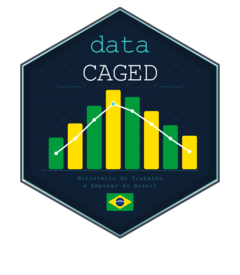
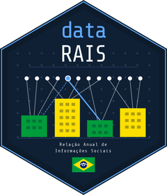

Os produtos a seguir foram desenvolvidos no âmbito das pesquisas do grupo [GECOMT](https://gecomt.github.io/) e têm por objetivo reduzir o custo de acesso a dados públicos brasileiros, favorecendo a reprodutibilidade dos estudos empíricos. Cada item indica o tipo de produção técnica e tecnológica correspondente, segundo a classificação adotada pela CAPES para a área de Administração Pública e de Empresas, Ciências Contábeis e Turismo.

## Software e aplicativos



CRANv0.2.3licençaMIT[DOI10.32614/CRAN.package.datacaged](https://doi.org/10.32614/CRAN.package.datacaged)

Software/AplicativoAbrangência nacional

### datacaged

Ferramentas para baixar, ler e armazenar os microdados do Cadastro Geral de Empregados e Desempregados (CAGED) em um banco local DuckDB, com suporte ao CAGED antigo (1992 a 2019), ao Novo CAGED (2020 em diante) e aos arquivos de ajustes. É o pacote que alimenta os [indicadores do emprego formal](#indicadores) publicados nesta página.

``` r
install.packages("datacaged")
```

[ Repositório](https://github.com/gecomt/datacaged) [ Página no CRAN](https://CRAN.R-project.org/package=datacaged) [ Tutorial no blog](../blog/posts/datacaged-tutorial/index.llms.md)



GitHubv0.1.0statusem desenvolvimentolicençaMIT

Software/AplicativoAbrangência nacional

### datarais

Acesso aos microdados da Relação Anual de Informações Sociais (RAIS), com vínculos de emprego e estabelecimentos de 1985 a 2025, armazenados em DuckDB. Os nomes de colunas são padronizados entre os diferentes leiautes históricos.

``` r
# install.packages("pak")
pak::pak("gecomt/datarais")
```

[ Repositório](https://github.com/gecomt/datarais)

INPIBR512024004498-1registro23/09/2024

Software/AplicativoRegistro no INPI

### cntdd

Programa de computador com registro concedido pelo Instituto Nacional da Propriedade Industrial (INPI).

## Bases de dados técnico-científicas

dadosCC BY 4.0códigoMITcobertura2010 a 2026

Base de dados técnico-científicaAbrangência nacional

### Segmentos de listagem da B3 por companhia (2010 a 2026)

Painel anual do segmento de listagem (Básico/Tradicional, Nível 1, Nível 2, Novo Mercado, Bovespa Mais e Bovespa Mais Nível 2) de cada companhia aberta brasileira, construído a partir do Formulário Cadastral (FCA) da Comissão de Valores Mobiliários (CVM) e conferido com documentos do sistema IPE. São 5.904 observações de 602 companhias, com arquivos para R, Stata, CSV e Excel e a metodologia detalhada.

[ Repositório](https://github.com/alexsandroprado/segmentos-b3) [ Apresentação no blog](../blog/posts/segmentos-b3/index.llms.md)

fonteMTEformato7z por competência

Base de dados técnico-científicaAbrangência nacional

### Microdados do CAGED e da RAIS no Hugging Face

Espelhos dos arquivos públicos do CAGED e da RAIS, organizados por período, que servem de fonte para os pacotes `datacaged` e `datarais`.

[ CAGED](https://huggingface.co/datasets/alexsandroprado/caged) [ RAIS](https://huggingface.co/datasets/alexsandroprado/rais)

## Emprego formal em números

Indicador mensal do mercado de trabalho formal, calculado a partir dos microdados do Novo Cadastro Geral de Empregados e Desempregados (Novo CAGED) com o pacote [datacaged](#datacaged) e atualizado automaticamente a cada nova divulgação.

Fonte: Ministério do Trabalho e Emprego, Novo CAGED (movimentações declaradas no prazo, sem ajustes). Elaboração própria com o pacote datacaged. Valores mensais por competência.

## Mercado de trabalho contábil

Admissões, desligamentos e salário de admissão das ocupações contábeis no emprego formal, segundo a Classificação Brasileira de Ocupações (CBO): Contador (2522-10), Auditor (2522-05), Perito contábil (2522-15), Técnico de contabilidade (3511-05) e Auxiliar de contabilidade (4131-10).

Fonte: Ministério do Trabalho e Emprego, Novo CAGED (movimentações declaradas no prazo). Elaboração própria com o pacote datacaged. O salário médio de admissão considera apenas admissões não intermitentes com salário contratual entre R\$ 500 e R\$ 60.000, em valores nominais; médias com menos de 10 admissões não são exibidas. O ano corrente reúne apenas os meses já divulgados.

## Cursos e eventos

Cursos de curta duração e eventos voltados à formação profissional, como o curso de análise de dados com Economatica e R e o Workshop de Coleta de Dados no Economatica, estão reunidos na página de [Extensão](../extensao/index.llms.md).

> **NOTE:**
>
> O enquadramento segue os tipos de produção técnica e tecnológica definidos pelo Grupo de Trabalho de Produção Técnica da CAPES e valorizados pela área de Administração Pública e de Empresas, Ciências Contábeis e Turismo. Para fins de avaliação, a produção é registrada no Currículo Lattes e informada pelo programa de pós-graduação na Plataforma Sucupira; esta página reúne a descrição e os links de comprovação pública de cada produto.

De volta ao topo
