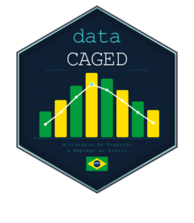
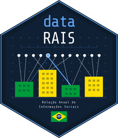
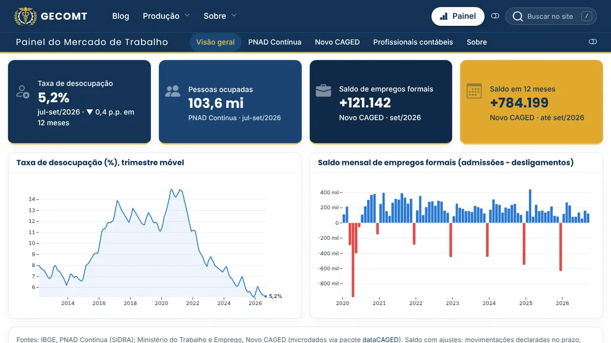

Os produtos a seguir foram desenvolvidos no âmbito das pesquisas do grupo [GECOMT](https://gecomt.github.io/) e têm por objetivo reduzir o custo de acesso a dados públicos brasileiros, favorecendo a reprodutibilidade dos estudos empíricos. Cada item indica o tipo de produção técnica e tecnológica correspondente, segundo a classificação adotada pela CAPES para a área de Administração Pública e de Empresas, Ciências Contábeis e Turismo.

## Software e aplicativos

:::: {.pt-grade}

::: {.pt-card .pt-card-largo}
```{=html}
<div class="pt-cab">
  
  <div class="pt-cab-txt">
    <div class="pt-selos"><span class="pt-selo selo-cran"><span>CRAN</span><span>v0.2.3</span></span><span class="pt-selo "><span>licença</span><span>MIT</span></span><a href="https://doi.org/10.32614/CRAN.package.datacaged" class="pt-selo-link"><span class="pt-selo selo-doi"><span>DOI</span><span>10.32614/CRAN.package.datacaged</span></span></a></div>
    <div class="pt-tipos"><span class="tipo-capes">Software/Aplicativo</span><span class="tipo-capes tipo-neutro">Abrangência nacional</span></div>
  </div>
</div>
```

### datacaged

Ferramentas para baixar, ler e armazenar os microdados do Cadastro Geral de Empregados e Desempregados (CAGED) em um banco local DuckDB, com suporte ao CAGED antigo (1992 a 2019), ao Novo CAGED (2020 em diante) e aos arquivos de ajustes. É o pacote que alimenta os [indicadores do emprego formal](#indicadores) publicados nesta página.

```r
install.packages("datacaged")
```

```{ojs}
//| echo: false
cran = FileAttachment("dados/cran_downloads.csv").csv()
cranDatacaged = cran.find(d => d.pacote === "datacaged")
fmtInt = new Intl.NumberFormat("pt-BR")
fmtMes = (s) => ["jan","fev","mar","abr","mai","jun","jul","ago","set","out","nov","dez"][+s.slice(5, 7) - 1] + "/" + s.slice(0, 4)
fmtDia = (s) => s.split("-").reverse().join("/")
html`<div class="downloads-cran">
  <div class="dl-item"><span class="dl-valor">${fmtInt.format(+cranDatacaged.total)}</span><span class="dl-rotulo">downloads desde ${fmtMes(cranDatacaged.primeiro_mes)}</span></div>
  <div class="dl-item"><span class="dl-valor">${fmtInt.format(+cranDatacaged.ultimos_30_dias)}</span><span class="dl-rotulo">nos últimos 30 dias</span></div>
  <div class="dl-fonte">Espelho do CRAN mantido pela Posit, via cranlogs · atualizado em ${fmtDia(cranDatacaged.atualizado_em)}</div>
</div>`
```

[<i class="bi bi-github"></i> Repositório](https://github.com/gecomt/datacaged){.pt-btn} [<i class="bi bi-box-seam"></i> Página no CRAN](https://CRAN.R-project.org/package=datacaged){.pt-btn} [<i class="bi bi-journal-code"></i> Tutorial no blog](/blog/posts/datacaged-tutorial/index.qmd){.pt-btn}
:::

::: {.pt-card}
```{=html}
<div class="pt-cab">
  
  <div class="pt-cab-txt">
    <div class="pt-selos"><span class="pt-selo selo-dev"><span>GitHub</span><span>v0.1.0</span></span><span class="pt-selo selo-dev"><span>status</span><span>em desenvolvimento</span></span><span class="pt-selo "><span>licença</span><span>MIT</span></span></div>
    <div class="pt-tipos"><span class="tipo-capes">Software/Aplicativo</span><span class="tipo-capes tipo-neutro">Abrangência nacional</span></div>
  </div>
</div>
```

### datarais

Acesso aos microdados da Relação Anual de Informações Sociais (RAIS), com vínculos de emprego e estabelecimentos de 1985 a 2025, armazenados em DuckDB. Os nomes de colunas são padronizados entre os diferentes leiautes históricos.

```r
# install.packages("pak")
pak::pak("gecomt/datarais")
```

[<i class="bi bi-github"></i> Repositório](https://github.com/gecomt/datarais){.pt-btn}
:::

::: {.pt-card}
```{=html}
<div class="pt-cab">
  <span class="pt-hex pt-hex-icone" aria-hidden="true"><i class="bi bi-shield-check"></i></span>
  <div class="pt-cab-txt">
    <div class="pt-selos"><span class="pt-selo selo-inpi"><span>INPI</span><span>BR512024004498-1</span></span><span class="pt-selo "><span>registro</span><span>23/09/2024</span></span></div>
    <div class="pt-tipos"><span class="tipo-capes">Software/Aplicativo</span><span class="tipo-capes tipo-neutro">Registro no INPI</span></div>
  </div>
</div>
```

### cntdd

Programa de computador com registro concedido pelo Instituto Nacional da Propriedade Industrial (INPI).
:::

::: {.pt-card .pt-card-largo .pt-card-painel #painel-gecomt}
```{=html}
<a class="pt-print" href="https://gecomt.github.io/dashboard/" target="_blank" rel="noopener"></a>
<div class="pt-cab">
  <span class="pt-hex pt-hex-icone" aria-hidden="true"><i class="bi bi-bar-chart-line"></i></span>
  <div class="pt-cab-txt">
    <div class="pt-selos"><span class="pt-selo selo-cran"><span>atualização</span><span>semanal</span></span><span class="pt-selo"><span>fontes</span><span>PNAD Contínua · Novo CAGED · RAIS</span></span><span class="pt-selo"><span>feito com</span><span>Quarto · R</span></span></div>
    <div class="pt-tipos"><span class="tipo-capes">Software/Aplicativo</span><span class="tipo-capes tipo-neutro">Abrangência nacional</span></div>
  </div>
</div>
```

### Painel do Mercado de Trabalho

Painel interativo do grupo GECOMT com indicadores do mercado de trabalho brasileiro e dos profissionais contábeis, organizado em quatro seções: (i) visão geral, com taxa de desocupação, pessoas ocupadas e saldo de empregos formais; (ii) PNAD Contínua, com indicadores, posição na ocupação, grupamentos de atividade e rendimentos; (iii) Novo CAGED, com movimentações por unidade da federação e setor; e (iv) profissionais contábeis, com dados do Novo CAGED e da RAIS. Os dados são atualizados automaticamente toda semana a partir do pacote `datacaged` e da API do SIDRA/IBGE.

[<i class="bi bi-bar-chart-line"></i> Acessar o painel](https://gecomt.github.io/dashboard/){.pt-btn} [<i class="bi bi-github"></i> Repositório](https://github.com/gecomt/gecomt.github.io/tree/main/dashboard){.pt-btn}
:::

::::

## Bases de dados técnico-científicas

:::: {.pt-grade}

::: {.pt-card}
```{=html}
<div class="pt-cab">
  <span class="pt-hex pt-hex-icone" aria-hidden="true"><i class="bi bi-buildings"></i></span>
  <div class="pt-cab-txt">
    <div class="pt-selos"><span class="pt-selo "><span>dados</span><span>CC BY 4.0</span></span><span class="pt-selo "><span>código</span><span>MIT</span></span><span class="pt-selo selo-cran"><span>cobertura</span><span>2010 a 2026</span></span></div>
    <div class="pt-tipos"><span class="tipo-capes">Base de dados técnico-científica</span><span class="tipo-capes tipo-neutro">Abrangência nacional</span></div>
  </div>
</div>
```

### Segmentos de listagem da B3 por companhia (2010 a 2026) {#segmentos-b3}

Painel anual do segmento de listagem (Básico/Tradicional, Nível 1, Nível 2, Novo Mercado, Bovespa Mais e Bovespa Mais Nível 2) de cada companhia aberta brasileira, construído a partir do Formulário Cadastral (FCA) da Comissão de Valores Mobiliários (CVM) e conferido com documentos do sistema IPE. São 5.904 observações de 602 companhias, com arquivos para R, Stata, CSV e Excel e a metodologia detalhada.

[<i class="bi bi-github"></i> Repositório](https://github.com/alexsandroprado/segmentos-b3){.pt-btn} [<i class="bi bi-journal-text"></i> Apresentação no blog](/blog/posts/segmentos-b3/index.qmd){.pt-btn}
:::

::: {.pt-card}
```{=html}
<div class="pt-cab">
  <span class="pt-hex pt-hex-icone" aria-hidden="true"><i class="bi bi-database"></i></span>
  <div class="pt-cab-txt">
    <div class="pt-selos"><span class="pt-selo "><span>fonte</span><span>MTE</span></span><span class="pt-selo "><span>formato</span><span>7z por competência</span></span></div>
    <div class="pt-tipos"><span class="tipo-capes">Base de dados técnico-científica</span><span class="tipo-capes tipo-neutro">Abrangência nacional</span></div>
  </div>
</div>
```

### Microdados do CAGED e da RAIS no Hugging Face

Espelhos dos arquivos públicos do CAGED e da RAIS, organizados por período, que servem de fonte para os pacotes `datacaged` e `datarais`.

[<i class="bi bi-database"></i> CAGED](https://huggingface.co/datasets/alexsandroprado/caged){.pt-btn} [<i class="bi bi-database"></i> RAIS](https://huggingface.co/datasets/alexsandroprado/rais){.pt-btn}
:::

::::

## Emprego formal em números {#indicadores}

Indicador mensal do mercado de trabalho formal, calculado a partir dos microdados do Novo Cadastro Geral de Empregados e Desempregados (Novo CAGED) com o pacote [datacaged](#datacaged) e atualizado automaticamente a cada nova divulgação.

::: {.indicador}

```{ojs}
//| echo: false
dados = FileAttachment("dados/caged_saldo.csv").csv({typed: true})
  .then(ds => ds.map(d => ({...d, data: new Date(d.competencia)})))

viewof recorte = Inputs.radio(
  ["Brasil", "Rio Grande do Norte", "Mossoró"],
  {value: "Rio Grande do Norte"}
)

viewof janela = Inputs.radio(
  new Map([["Últimos 24 meses", 24], ["Desde 2020", 1000]]),
  {value: 24}
)
```

```{ojs}
//| echo: false
serie = dados
  .filter(d => d.recorte === recorte)
  .sort((a, b) => a.data - b.data)

recorteJanela = serie.slice(-janela)
ultimo = serie[serie.length - 1]
anoUltimo = ultimo.data.getUTCFullYear()
acumAno = d3.sum(serie.filter(d => d.data.getUTCFullYear() === anoUltimo), d => d.saldo)
acum12 = d3.sum(serie.slice(-12), d => d.saldo)

fmt = v => (v > 0 ? "+" : "") + v.toLocaleString("pt-BR")
mesAno = d => d.toLocaleDateString("pt-BR", {month: "long", year: "numeric", timeZone: "UTC"})
mesCurto = d => d.toLocaleDateString("pt-BR", {month: "short", year: "2-digit", timeZone: "UTC"}).replace(". de ", "/").replace(" de ", "/")

html`<div class="kpis">
  <div class="kpi"><div class="kpi-rotulo">Saldo do mês</div>
    <div class="kpi-valor">${fmt(ultimo.saldo)}</div>
    <div class="kpi-nota">${mesAno(ultimo.data)}</div></div>
  <div class="kpi"><div class="kpi-rotulo">Acumulado no ano</div>
    <div class="kpi-valor">${fmt(acumAno)}</div>
    <div class="kpi-nota">janeiro a ${ultimo.data.toLocaleDateString("pt-BR", {month: "long", timeZone: "UTC"})} de ${anoUltimo}</div></div>
  <div class="kpi"><div class="kpi-rotulo">Últimos 12 meses</div>
    <div class="kpi-valor">${fmt(acum12)}</div>
    <div class="kpi-nota">soma dos saldos mensais</div></div>
  <div class="kpi"><div class="kpi-rotulo">Admissões no mês</div>
    <div class="kpi-valor">${ultimo.admissoes.toLocaleString("pt-BR")}</div>
    <div class="kpi-nota">${ultimo.desligamentos.toLocaleString("pt-BR")} desligamentos</div></div>
</div>`
```

```{ojs}
//| echo: false
Plot.plot({
  height: 260,
  marginLeft: 64,
  style: {fontFamily: "IBM Plex Mono, monospace", fontSize: "11px", background: "transparent"},
  x: {type: "band", label: null, tickFormat: d => mesCurto(new Date(d)),
      ticks: recorteJanela.filter((d, i) => i % (janela > 24 ? 6 : 3) === 0).map(d => d.data.getTime())},
  y: {label: "Saldo (admissões menos desligamentos)", grid: true,
      tickFormat: v => v.toLocaleString("pt-BR")},
  color: {domain: [true, false], range: ["#1f8fae", "#d97706"]},
  marks: [
    Plot.ruleY([0], {stroke: "#94a3b8"}),
    Plot.barY(recorteJanela, {
      x: d => d.data.getTime(), y: "saldo", fill: d => d.saldo >= 0,
      inset: 0.5,
      title: d => `${mesAno(d.data)}\nSaldo: ${fmt(d.saldo)}\nAdmissões: ${d.admissoes.toLocaleString("pt-BR")}\nDesligamentos: ${d.desligamentos.toLocaleString("pt-BR")}`,
      tip: true
    })
  ]
})
```

::: {.fonte-dados}
Fonte: Ministério do Trabalho e Emprego, Novo CAGED (movimentações declaradas no prazo, sem ajustes). Elaboração própria com o pacote datacaged. Valores mensais por competência.
:::

:::

## Mercado de trabalho contábil {#contabil}

Admissões, desligamentos e salário de admissão das ocupações contábeis no emprego formal, segundo a Classificação Brasileira de Ocupações (CBO): Contador (2522-10), Auditor (2522-05), Perito contábil (2522-15), Técnico de contabilidade (3511-05) e Auxiliar de contabilidade (4131-10).

::: {.indicador}

```{ojs}
//| echo: false
contabil = FileAttachment("dados/caged_contabil.csv").csv({typed: true})
  .then(ds => ds.map(d => ({...d, data: new Date(d.competencia), ano: new Date(d.competencia).getUTCFullYear()})))

ocupacoesTodas = ["Contador", "Auditor", "Perito contábil", "Técnico de contabilidade", "Auxiliar de contabilidade"]

viewof recorteCont = Inputs.radio(
  ["Brasil", "Nordeste", "Rio Grande do Norte"],
  {value: "Rio Grande do Norte"}
)

viewof ocupSel = Inputs.checkbox(ocupacoesTodas, {value: ocupacoesTodas})
```

```{ojs}
//| echo: false
contR = contabil.filter(d => d.recorte === recorteCont && ocupSel.includes(d.ocupacao))
compsCont = [...new Set(contabil.map(d => d.data.getTime()))].sort((a, b) => a - b)
ult12 = new Set(compsCont.slice(-12))
ultimaCont = new Date(compsCont[compsCont.length - 1])
inicio12 = new Date(compsCont[compsCont.length - 12])
c12 = contR.filter(d => ult12.has(d.data.getTime()))
somaC = (arr, k) => d3.sum(arr, d => d[k])
salMedio = arr => somaC(arr, "salario_soma") / Math.max(1, somaC(arr, "salario_n"))
brl = v => v.toLocaleString("pt-BR", {style: "currency", currency: "BRL", maximumFractionDigits: 0})
periodo12 = `${mesCurto(inicio12)} a ${mesCurto(ultimaCont)}`

html`<div class="kpis">
  <div class="kpi"><div class="kpi-rotulo">Admissões (12 meses)</div>
    <div class="kpi-valor">${somaC(c12, "admissoes").toLocaleString("pt-BR")}</div>
    <div class="kpi-nota">${periodo12}</div></div>
  <div class="kpi"><div class="kpi-rotulo">Saldo (12 meses)</div>
    <div class="kpi-valor">${fmt(somaC(c12, "admissoes") - somaC(c12, "desligamentos"))}</div>
    <div class="kpi-nota">admissões menos desligamentos</div></div>
  <div class="kpi"><div class="kpi-rotulo">Salário médio de admissão</div>
    <div class="kpi-valor">${brl(salMedio(c12))}</div>
    <div class="kpi-nota">últimos 12 meses, valor nominal</div></div>
</div>`
```

```{ojs}
//| echo: false
tabela12 = ocupSel.map(o => {
  const r = c12.filter(d => d.ocupacao === o)
  return {o, adm: somaC(r, "admissoes"), desl: somaC(r, "desligamentos"), sal: salMedio(r), n: somaC(r, "salario_n")}
})

html`<table class="table table-sm tabela-contabil">
  <thead><tr><th>Ocupação</th><th>Admissões</th><th>Desligamentos</th><th>Saldo</th><th>Salário médio de admissão</th></tr></thead>
  <tbody>${tabela12.map(r => html`<tr>
    <td>${r.o}</td>
    <td>${r.adm.toLocaleString("pt-BR")}</td>
    <td>${r.desl.toLocaleString("pt-BR")}</td>
    <td class="${r.adm - r.desl < 0 ? "neg" : ""}">${fmt(r.adm - r.desl)}</td>
    <td>${r.n >= 10 ? brl(r.sal) : "—"}</td></tr>`)}</tbody>
</table>`
```

```{ojs}
//| echo: false
salAnual = d3.flatRollup(contR, v => ({sal: salMedio(v), n: somaC(v, "salario_n")}), d => d.ano, d => d.ocupacao)
  .map(([ano, ocupacao, v]) => ({ano, ocupacao, ...v, sal: v.n >= 10 ? v.sal : NaN}))
  .sort((a, b) => a.ano - b.ano)

Plot.plot({
  height: 280,
  marginLeft: 70,
  style: {fontFamily: "IBM Plex Mono, monospace", fontSize: "11px", background: "transparent"},
  x: {label: null, tickFormat: d => String(d), ticks: [...new Set(salAnual.map(d => d.ano))]},
  y: {label: "Salário médio de admissão (R$, nominal)", grid: true, tickFormat: v => v.toLocaleString("pt-BR")},
  color: {domain: ocupacoesTodas, range: ["#0e7490", "#7c3aed", "#d97706", "#64748b", "#94a3b8"], legend: true},
  marks: [
    Plot.line(salAnual, {x: "ano", y: "sal", stroke: "ocupacao", strokeWidth: 2}),
    Plot.dot(salAnual.filter(d => d.n >= 10), {x: "ano", y: "sal", fill: "ocupacao", r: 3,
      title: d => `${d.ocupacao}, ${d.ano}\n${brl(d.sal)} (${d.n.toLocaleString("pt-BR")} admissões)`, tip: true})
  ]
})
```

::: {.fonte-dados}
Fonte: Ministério do Trabalho e Emprego, Novo CAGED (movimentações declaradas no prazo). Elaboração própria com o pacote datacaged. O salário médio de admissão considera apenas admissões não intermitentes com salário contratual entre R$ 500 e R$ 60.000, em valores nominais; médias com menos de 10 admissões não são exibidas. O ano corrente reúne apenas os meses já divulgados.
:::

:::

## Cursos e eventos

Cursos de curta duração e eventos voltados à formação profissional, como o curso de análise de dados com Economatica e R e o Workshop de Coleta de Dados no Economatica, estão reunidos na página de [Extensão](../extensao/index.qmd).

::: {.callout-note appearance="simple"}
## Sobre a classificação

O enquadramento segue os tipos de produção técnica e tecnológica definidos pelo Grupo de Trabalho de Produção Técnica da CAPES e valorizados pela área de Administração Pública e de Empresas, Ciências Contábeis e Turismo. Para fins de avaliação, a produção é registrada no Currículo Lattes e informada pelo programa de pós-graduação na Plataforma Sucupira; esta página reúne a descrição e os links de comprovação pública de cada produto.
:::
